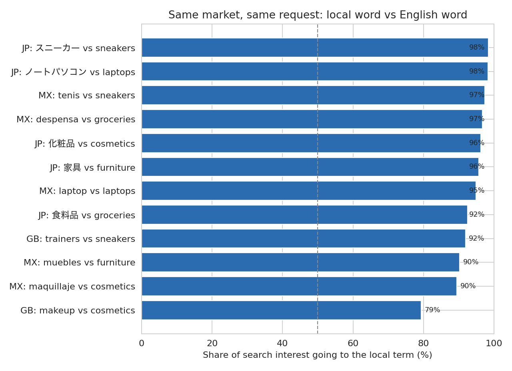
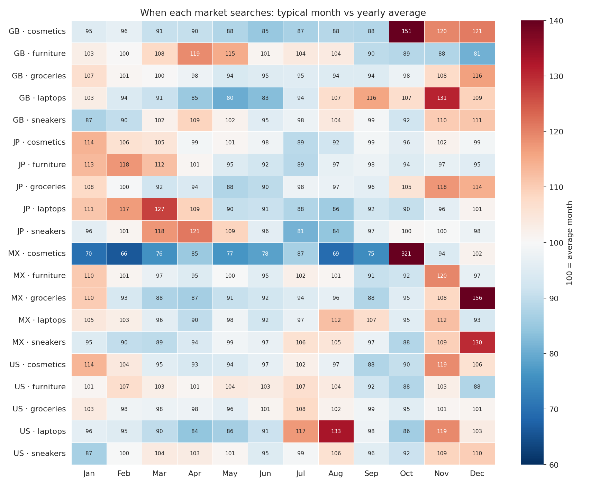
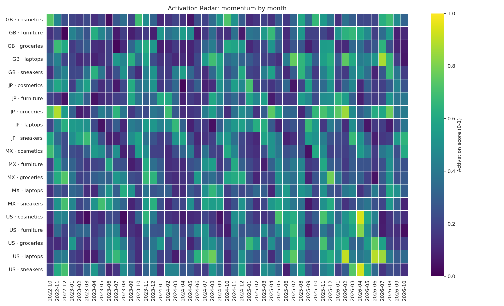

# Retail Trend & Activation Radar

[](https://github.com/SylviaZam/Retail-Trend-Activation-Radar/actions/workflows/tests.yml)

When does each market start looking for a product, and what word does it use to search? This project pulls five years of weekly Google Trends data for five retail concepts in four markets (United States, United Kingdom, Japan, Mexico), searching in each market's own language. It turns that data into three things a launch team can use: each market's seasonal calendar, a check on whether the English keyword reaches local shoppers at all, and a month-by-month momentum score. The outputs are an Excel workbook and charts, rebuilt automatically every month.

## What the data shows (run of October 2026, weekly data Oct 2021 to Oct 2026)

**1. An English keyword list misses most non-English markets.** In Japan the local word takes 92-98% of combined search interest for every concept. Searches there are for スニーカー (98%), not "sneakers". The same holds in Mexico (90-97%) and even in the UK, where "trainers" takes 92% against "sneakers". A tracker built on US keywords would be measuring almost nothing in those markets.



**2. The same product peaks in different months in different markets.** Laptops peak in August in the US (33% above an average month), in March in Japan (+27%), and in November in the UK (+31%). These months are plausibly the US back-to-school season, Japan's April school and fiscal-year start, and Black Friday, but the data shows timing, not causes. Sneakers peak in April in Japan and in December in Mexico. In Mexico, "maquillaje" (makeup) runs at more than 3x its usual level every October, around Día de Muertos and Halloween; no other market has a swing that large. A single global campaign calendar would be early or late in most of these markets.



**3. Momentum, month by month.** The activation score flags months where a series is running well above its own recent level and above last year. It is a screening aid for "what is heating up now", read next to the seasonal calendar above.



## How it works

1. **Collect.** `config/markets.json` lists the term people in each market would type for each concept (for example, Japan: ノートパソコン for laptops). Each term is requested on its own, so every series uses the full 0-100 Trends scale. The current, still-incomplete week is dropped.
2. **Seasonal calendar.** For each complete calendar year, each month's average is divided by that year's average. Dividing by the year removes growth or decline across years. The results are averaged across the four complete years, so **100 = an average month** and 130 = typically 30% above.
3. **Local vs English.** For every concept where the local term differs from English, both are requested together, so they share one scale. `local_share = local / (local + English)` over the five years.
4. **Momentum score**, per month: `0.6 × z-score + 0.3 × year-over-year growth + 0.1 × share of hot weeks`, with each part scaled 0-1.
   - z-score: the 4-week moving average against its own last 12 weeks.
   - Year-over-year: this week against the same week last year, clipped to 80-200.
   - Hot week: z ≥ 1.2.
   - Months without a year of history are not scored.

All features compare a series with its own past. Google scales each request separately, so absolute search volume is never compared across terms or markets.

## Limitations

- **Search interest is not demand.** Treat these results as timing hypotheses, and confirm them with sales, site, or survey data before committing budget.
- **The keyword choices are the author's.** A native speaker in each market should review them. Some terms carry more than one meaning ("tenis" in Mexico also means the sport), which adds noise.
- **Google Trends samples its data**, so values move slightly between pulls. Peak months matched across two separate pulls in October 2026, but small differences of a few points shouldn't be read into.
- **The score weights (0.6 / 0.3 / 0.1) are a judgment call**, not fitted to an outcome. Before using the score to decide anything, rerun it with other weights and check that the top months still lead.
- **Four complete years per series** is enough to see a repeating pattern but not to estimate its uncertainty well.

## Run it

```bash
python -m venv .venv && source .venv/bin/activate
pip install -r requirements.txt

python -m src.radar_cli                              # all markets in config/markets.json
python -m src.radar_cli --only US,JP                 # a subset
python -m src.radar_cli --geo GB --keywords trainers,makeup   # quick one-off market
```

Google limits how often it answers. The tool spaces out its requests and retries after 20, 40, and 80 seconds. If Google still refuses, the tool exits with code 75 and leaves the previous outputs as they were. The monthly GitHub Action treats that exit as "skip this month" instead of a failure.

**Tests** run offline against synthetic series with known answers and a fake Trends client:

```bash
pip install -r requirements-dev.txt && python -m pytest -q
```

## Outputs

| File | What it holds |
|---|---|
| `reports/activation_radar.xlsx` | Sheets: Readme, Market_Peaks, Seasonality, Localization, Activation_Radar, Top_Months, Signals_preview |
| `data/trends_signals.csv` | Weekly interest plus engineered features, per market and concept |
| `data/localization_pairs.csv` | Weekly local-term vs English-term interest |
| `assets/*.png` | The three charts above |

## Repository layout

```
config/markets.json        markets, languages, and local search terms
src/radar.py               features, seasonality, localization share, scoring (pure pandas)
src/trends.py              Google Trends access with pacing and retries
src/report.py              Excel workbook and charts
src/radar_cli.py           command-line entry point
tests/                     offline tests (pytest)
notebooks/                 original 2025 exploration (single US market)
.github/workflows/         tests on every push; data refresh monthly
```

Built by [Sylvia Zamora](https://sylviazamora.com). Data: Google Trends via [pytrends](https://github.com/GeneralMills/pytrends).
